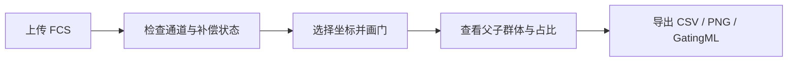

# FlowGate · 流式细胞术分析工作台

在浏览器中完成 **FCS 上传、荧光补偿、交互门控和群体统计导出**。适合教学演示、小实验室的单文件分析，以及需要保留门模板的研究流程。

*Self-hosted FCS analysis with compensation, interactive gates and exports.*

**[启动并试用](#启动并试用)** · [公开 FCS 样例](examples/fcs/) · [示例门模板](examples/gatingml/8_color_ICS.xml) · [开发与 API](docs/DEVELOPMENT.md)

[](https://github.com/tomaxiwu-bit/flowgate/actions/workflows/ci.yml)

FlowGate 需要先在本机或可信环境部署。部署后，使用者通过浏览器操作，无需编写分析脚本；也提供维护者按需开启的临时公网实例（见下节）。

## 一份 FCS 可以怎样分析



| 分析环节 | 当前能力 | 你能核查什么 |
|---|---|---|
| 读取数据 | 解析 FCS，检查文件内嵌 `$SPILLOVER` | 通道、事件数与补偿是否实际应用 |
| 观察分布 | Canvas 散点图，线性 / Logicle 显示 | 补偿后负值与荧光分布 |
| 划分群体 | 矩形门、多边形门与父子门树 | 门内事件和群体占比 |
| 保存结果 | 全量事件统计 CSV、PNG、GatingML 2.0 子集 | 统计数值与可交换的门模板 |

仓库附带 FlowKit 公开的 **8 色 ICS 样例，约 29 万事件**，以及配套门模板，可用于走通一次完整流程。图上的抽样显示与统计导出采用的全量事件应区分阅读。

## 在线试用

<https://flowgate-gy96.onrender.com>

Render 免费实例（512MB 内存 / 0.1 CPU，Singapore）。打开后上传 `examples/fcs/101_DEN084Y5_15_E01_008_clean.fcs`（约 17 MB），可完整走一遍「上传 → 补偿状态 → 画门 → 占比 → 导出」。几点如实说明：

- 免费实例 15 分钟无访问会休眠，下次访问需要约 1 分钟冷启动。
- 算力只有 0.1 CPU：17 MB 样例上传并解析约需 3–5 分钟（实测 276 秒）；解析完成后，门控评估是秒级（实测 2.4 秒，179,296 事件 / 61.7896%，子门 31,589 / 10.8863%）。
- 没有登录与鉴权，上传文件只留在该实例的临时目录，实例重启即清空。不要上传真实实验数据。
- 单文件上限 100 MB（受免费档内存限制）。

## 部署到公网（免费档）

仓库带 `render.yaml`，一个 Docker 服务即可上线，不需要信用卡。

一键入口：<https://render.com/deploy?repo=https://github.com/tomaxiwu-bit/flowgate>

1. 用 GitHub 账号登录 <https://render.com>。
2. 控制台 New → Blueprint → 选中 `flowgate` 仓库 → Apply。
3. 构建完成后拿到 `https://flowgate-xxxx.onrender.com`，打开 `/upload` 就能用。

免费档是 512MB 内存、0.1 CPU，镜像默认按这个量级调参：单文件上限 100MB（`FLOWGATE_MAX_UPLOAD_MB`）、常驻 Sample 缓存 2（`FLOWGATE_SAMPLE_CACHE_SIZE`）。免费实例 15 分钟无访问会休眠，下次访问冷启动约 1 分钟。

自建服务器：

```bash
docker build -t flowgate .
docker run -d -p 8080:8080 -e PORT=8080 -e FLOWGATE_PUBLIC_HOST=demo.example.com flowgate
```

`FLOWGATE_PUBLIC_HOST` 会写进后端的 TrustedHost 与 CORS 白名单。不设的话，来自该域名的所有写请求都会被 403 —— 这个问题在浏览器上表现为"上传失败"，日志里却是 `不允许的请求来源`。

## 本地启动并试用

推荐从 Docker 启动。需要 Git 和可运行 Docker Compose 的环境：

```powershell
git clone https://github.com/tomaxiwu-bit/flowgate.git
Set-Location flowgate
docker compose up --build
```

打开 <http://localhost:3000/upload>。首次构建需要下载依赖，之后按下面步骤使用：

1. 上传 `examples/fcs/101_DEN084Y5_15_E01_008_clean.fcs`。
2. 进入分析，先查看通道和补偿状态。文件内的补偿矩阵不可用时，界面会明确提示回退到未补偿数据。
3. 选择坐标；在**线性模式**画矩形门或多边形门。选中已有门后，新门会作为它的子门。
4. 查看门内事件与占比，再导出统计 CSV、图像 PNG 或 GatingML 模板。也可导入 `examples/gatingml/8_color_ICS.xml`。

不使用 Docker 时，按 [本地开发指南](docs/DEVELOPMENT.md) 分别启动 Python 3.12 后端和 Next.js 前端。后端健康检查位于 <http://localhost:8000/api/health>。

## 使用前需要知道

**当前是无账号体系的本地 / 可信环境工具。** 上传文件会保存到服务端，尚无自动清理或多用户隔离；默认 Docker 端口只绑定本机。需要远程共享时，应先补访问控制并确认文件管理方式。

门控与导出采用补偿线性坐标；Logicle 用于查看，暂不支持在其空间内直接画门。GatingML 当前支持矩形门和多边形门，Boolean / Quadrant 门会被跳过。与其他软件交换模板时，须核对所用补偿、变换与坐标约定。

尚未提供直方图、批量分析、门控撤销 / 重做。当前范围与接口细节见 [开发参考](docs/DEVELOPMENT.md)。

## 代码与文档

| 位置 | 内容 |
|---|---|
| `frontend/` | Next.js + TypeScript，上传、散点图与门控界面 |
| `backend/` | FastAPI + FlowKit，解析、补偿、门评估与导出 |
| `examples/` | 可供试用的公开 FCS 与 GatingML 文件 |
| [开发参考](docs/DEVELOPMENT.md) | 本地启动、数据空间、API、已知边界 |
| [部署说明](docs/DEPLOY_HUGGINGFACE_SPACES.md) | 容器构建参考；部署前仍需满足访问控制要求 |

CI 执行后端测试、覆盖率门槛和前端检查；当前状态见上方 CI 链接。问题反馈请附软件版本、补偿状态和复现步骤，并优先使用仓库公开样例描述问题。

代码采用 [MIT](LICENSE)。FCS 解析与门评估基于 [FlowKit](https://github.com/whitews/flowkit)。
